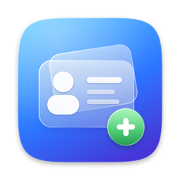
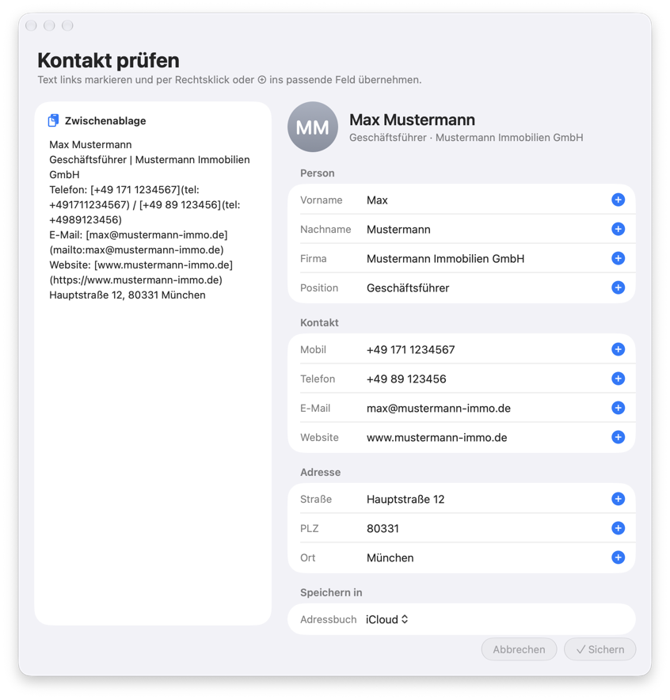

<p align="center">
  
</p>

# Kontakt-Import

[English](README.md) · **Deutsch**

Eine kleine Menüleisten-App für macOS, die kopierte Kontaktdaten (etwa aus einer
E-Mail-Signatur) in die Kontakte-App übernimmt. Text kopieren, Tastenkürzel
drücken oder auf das Menüleisten-Symbol klicken, die erkannten Felder kurz
prüfen und sichern.

<p align="center">
  
</p>

## Download

Die fertige App gibt es als `ContactImporter.zip` unter
[Releases](https://github.com/abrocker/contact-import/releases/latest).
Nach dem Entpacken den Abschnitt [Installieren](#installieren) beachten.

Gedacht für Signaturen wie diese:

```
Max Mustermann
Geschäftsführer | Mustermann Immobilien GmbH
Telefon: [+49 171 1234567](tel:+491711234567) / [+49 89 123456](tel:+4989123456)
E-Mail: [max@mustermann-immo.de](mailto:max@mustermann-immo.de)
Website: [www.mustermann-immo.de](https://www.mustermann-immo.de)
Hauptstraße 12, 80331 München
```

Fehlende Zeilen sind kein Problem, und reiner Text ohne Markdown-Links
(`Telefon: 0171 …` statt `[…](tel:…)`) wird ebenfalls erkannt.

## Funktionen

- **Automatische Erkennung** von Name, Firma, Position, Telefon- und
  Mobilnummer, E-Mail, Website und Adresse
- **Prüfen vor dem Sichern** in einem Fenster mit dem Originaltext links und
  den erkannten Feldern rechts
- **Felder per Markierung und Rechtsklick füllen:** Text links markieren,
  rechtsklicken und das Zielfeld wählen. Ohne Markierung übernimmt ein
  Rechtsklick die ganze angeklickte Zeile.
- **Adressbuch wählen**, wenn mehrere vorhanden sind (iCloud, Exchange,
  „Auf meinem Mac“ …)
- **Globales Tastenkürzel**, das den Import aus jeder App heraus öffnet
- Design im Stil von macOS 26/27 mit Liquid Glass, hellem und dunklem Modus

## Voraussetzungen

- macOS 26 oder neuer (die Glas-Effekte gibt es erst ab dieser Version)
- Apple-Silicon- oder Intel-Mac
- Zum Bauen: Xcode bzw. die Command Line Tools mit dem macOS-26-SDK oder neuer
  (`xcode-select --install`)

## Bauen

```bash
git clone https://github.com/abrocker/contact-import.git
cd contact-import
./build.sh
```

Das Skript

1. kompiliert `main.swift` für Apple Silicon und Intel und fügt beides zu
   einem Universal Binary zusammen,
2. baut daraus `ContactImporter.app` samt Symbol,
3. signiert die App ad hoc (ohne diese Signatur meldet macOS die App auf
   anderen Macs als „beschädigt“),
4. packt sie als `ContactImporter.zip` zum Weitergeben.

## Installieren

```bash
mv ContactImporter.app /Applications/
```

Die App ist nur ad hoc signiert, nicht mit einem Apple-Entwicklerzertifikat,
und nicht notarisiert. Auf dem Mac, auf dem sie gebaut wurde, startet sie
direkt. Auf anderen Macs blockiert Gatekeeper den ersten Start:

1. `ContactImporter.zip` entpacken und die App nach `/Applications` legen.
2. Einmalig im Terminal die Quarantäne-Markierung entfernen:
   ```bash
   xattr -cr /Applications/ContactImporter.app
   ```
   Alternativ die App einmal öffnen und unter
   **Systemeinstellungen → Datenschutz & Sicherheit** auf
   **Trotzdem öffnen** klicken.

Die App hat kein Dock-Symbol. Sie läuft nur über das Personen-Symbol in der
Menüleiste und wird dort über **Beenden** geschlossen.

## Berechtigungen

| Berechtigung | Wofür | Wo einstellen |
|---|---|---|
| Kontakte | Adressbücher auflisten und Kontakte sichern. macOS fragt beim ersten Import. | Systemeinstellungen → Datenschutz & Sicherheit → Kontakte |
| Bedienungshilfen | Nur für das globale Tastenkürzel. Ohne sie reagiert das Kürzel nicht, das Menüleisten-Symbol funktioniert trotzdem. | Systemeinstellungen → Datenschutz & Sicherheit → Bedienungshilfen → ContactImporter aktivieren (fehlt der Eintrag, über **+** hinzufügen) |

## Benutzung

1. Kontakttext kopieren.
2. Das Tastenkürzel drücken oder im Menüleisten-Menü
   **Aus Zwischenablage erstellen** wählen.
3. Im Fenster **Kontakt prüfen** die erkannten Felder kontrollieren. Der Kopf
   mit Avatar und Namen zeigt live, wie der Kontakt aussehen wird.
4. Falsch oder nicht erkannte Felder korrigieren:
   - direkt ins Feld tippen,
   - links Text markieren, **rechtsklicken** und das Zielfeld wählen,
   - oder links markieren und rechts in der passenden Zeile auf **⊕** klicken.
5. Bei mehreren Adressbüchern unter **Speichern in** das Ziel wählen.
6. **Sichern** (Return) speichert den Kontakt, **Abbrechen** (Esc) verwirft ihn.

### Adressbuch festlegen

Gibt es mehr als ein Adressbuch, erscheinen zwei Auswahlmöglichkeiten:

- im Menüleisten-Menü unter **Adressbuch** (das aktuelle ist abgehakt),
- im Fenster **Kontakt prüfen** unter **Speichern in**.

Beide teilen sich dieselbe Einstellung, und die App merkt sich die Wahl über
Neustarts hinweg. Existiert das gewählte Adressbuch nicht mehr, nimmt die App
das Standard-Adressbuch von macOS. Bei nur einem Adressbuch bleibt die Auswahl
ausgeblendet.

### Tastenkürzel festlegen

Im Menüleisten-Menü **Tastenkürzel festlegen…** wählen, die gewünschte
Kombination drücken (mindestens ⌘, ⌥ oder ⌃) und **Übernehmen** klicken.
**Entfernen** löscht das Kürzel wieder. Das aktuelle Kürzel steht im Menü
hinter **Aus Zwischenablage erstellen**.

## Was erkannt wird

- **Name:** die erste Zeile, die zu keinem anderen Muster passt. Das erste
  Wort wird zum Vornamen, der Rest zum Nachnamen.
- **Position | Firma:** Bei einer Zeile mit `|` gilt der linke Teil als
  Position, der rechte als Firma.
- **Firma** auch ohne `|`, wenn die Zeile Begriffe wie „GmbH“, „AG“, „KG“,
  „UG“, „Immobilien“ oder „Inh.“ enthält.
- **Telefon:** `tel:`-Links, Zeilen mit „Telefon“, „Tel“, „Mobil“, „Fax“ oder
  „Phone“ sowie Zeilen, die nur aus Ziffern, `+`, `/` und Leerzeichen bestehen.
  Mehrere Nummern (getrennt durch `/` oder `,`) werden verteilt: deutsche
  Mobilnummern (015x, 016x, 017x) kommen ins Feld **Mobil**, alle anderen ins
  Feld **Telefon**.
- **E-Mail:** `mailto:`-Links oder das Muster `name@domain.tld`.
- **Website:** `http(s)`-Links oder Zeilen mit „Website“, „Web“ oder „Internet“.
- **Adresse:** eine Zeile mit Postleitzahl (4–5 Ziffern) und Ort. Alles davor
  wird zur Straße. Als Land wird immer „Deutschland“ eingetragen.

## Projektaufbau

| Datei | Inhalt |
|---|---|
| `main.swift` | Die ganze App: Parser, Speichern, Fenster, Tastenkürzel, Menü |
| `Info.plist` | Bundle-Infos, Mindestversion, Text der Kontakte-Abfrage |
| `build.sh` | Baut, signiert und packt die App |
| `AppIcon.icns` | Das App-Symbol |
| `tools/make_icon.swift` | Zeichnet das Symbol per Code |
| `tools/make_icon.sh` | Erzeugt daraus `AppIcon.icns` und `docs/icon.png` |

## Anpassen

Die wichtigsten Stellen in `main.swift`:

- **Erkennung:** `enum ClipboardParser`. Weitere Firmenbegriffe kommen in
  `companySuffixPattern`, die Aufteilung der Telefonnummern steckt in
  `assignPhone(_:to:)`.
- **Land der Adresse:** `ContactSaver.save`, Zeile
  `addr.country = "Deutschland"`.
- **Weitere Felder:** `ParsedContact` erweitern, das Feld in `sections` in
  `EditorWindowController.buildUI()` ergänzen und in `saveTapped()` auslesen.
  Das Rechtsklick-Menü übernimmt neue Felder automatisch.
- **Farben und Abstände:** `enum Theme`.
- **Symbol:** `tools/make_icon.swift` ändern und `./tools/make_icon.sh`
  ausführen.

Nach jeder Änderung `./build.sh` erneut ausführen.

## Bekannte Grenzen

- Genau zwei Telefonfelder (Mobil und Telefon) und genau eine Adresse
- Das Land ist fest auf „Deutschland“ gesetzt
- Die App reagiert nicht von selbst auf jeden Kopiervorgang, sondern nur auf
  Klick oder Tastenkürzel. Das ist Absicht.
- Ohne Apple-Entwicklerkonto ist keine Notarisierung möglich, daher der
  einmalige Gatekeeper-Schritt auf anderen Macs

## Lizenz

[MIT](LICENSE)
